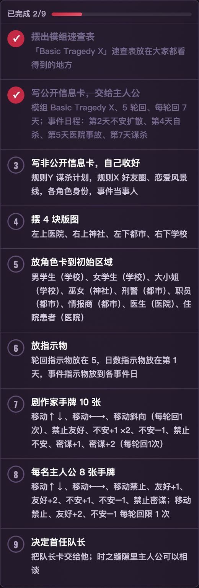
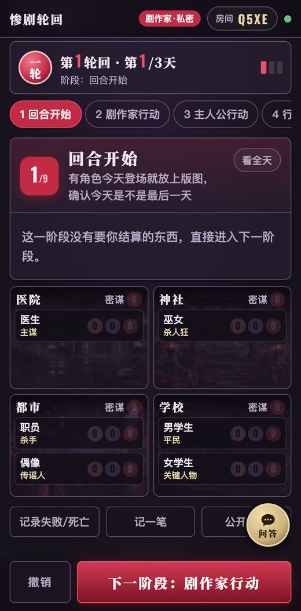
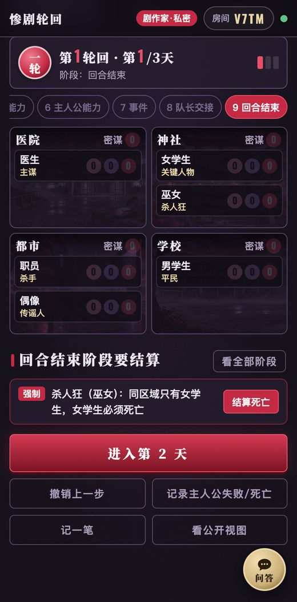
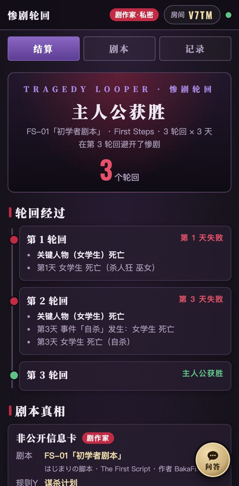
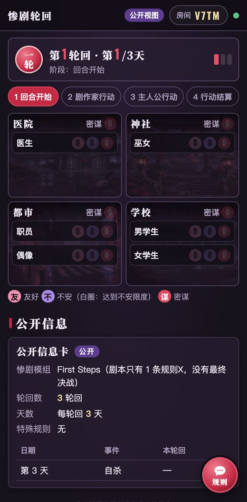

<div align="center">

# 惨剧轮回剧作家助手

**设好剧本，算清惨剧**

《惨剧轮回》（Tragedy Looper / 惨劇RoopeR）线下对局的剧作家工具：选剧本、看路线建议、照清单摆放，对局中记录轮回、天数和指示物，每个阶段提醒该结算什么，最后结算并保存长图。

剧作家用手机建房间，看到的是私密视图；主人公扫码进同一个房间，只能看到公开信息。隐藏信息在服务端就过滤掉了。

「匹兹堡开局小助手」的姊妹站。

**[立即使用 → tl.leisurecat.cloud](https://tl.leisurecat.cloud)**


</div>

---

## 功能一览

### 剧本库：基础版 10 个官方剧本

收录《惨剧RoopeR 5th》基础版（中文版《惨剧轮回》）的 10 个剧本，按剧本书顺序：

| 编号 | 中文名 | 日文名 | 模组 | 天数 | 轮回 / 难度 |
|---|---|---|---|---|---|
| FS-01 | 初学者剧本 | はじまりの脚本 | First Steps | 3 | 3 / 1 |
| FS-02 | 没有神灵的神宫 | 神亡き宮にて | First Steps | 4 | 3 / 1 |
| BTX-01 | 魔法少女万能论 | 魔法少女万能論 | Basic Tragedy X | 5 | 4 / 2，3 / 3 |
| BTX-02 | 猫箱 | 猫の箱 | Basic Tragedy X | 5 | 4 / 3，3 / 5 |
| BTX-03 | 来自未来的刺客 | 未来からの刺客 | Basic Tragedy X | 5 | 5 / 3，4 / 5 |
| BTX-04 | 辽阳医院的遗留物 | 泥ノ木病棟に遺されて | Basic Tragedy X | 6 | 5 / 4，4 / 5 |
| BTX-05 | 拥有抗体的人 | 抗体を持つ者たち | Basic Tragedy X | 4 | 5 / 4，4 / 6 |
| BTX-06 | unrerum | unrerum | Basic Tragedy X | 6 | 4 / 6 |
| BTX-07 | 序文 | 序文 | Basic Tragedy X | 7 | 5 / 5，4 / 7 |
| BTX-08 | Happy&Bad NeverEnding Story | 同左 | Basic Tragedy X | 6 | 4 / 8 |

每个剧本有：公开信息卡、非公开信息卡（规则Y/X、身份、事件当事人、特记事项）、核心机制、路线建议（优先走哪条失败条件、在谁身上放密谋或不安）、怎么守住真相、本剧本易错点。剧本库有剧透警告，主人公别点。

<p>

</p>

### 设置：按清单摆放

建房间后先进入选剧本页；点一个剧本就进入它的设置页，顶部大卡片显示选中的剧本，可以随时点「换剧本」回到列表。选好轮回数后，助手列出摆放清单：模组速查表、公开信息卡和非公开信息卡要写什么、4 块版图、每个角色的初始区域（神灵第几轮回登场、转校生第几天登场、大人物的领地、手下的初始区域由剧作家每轮回选）、指示物、剧作家和主人公的手牌（含特殊规则拿掉的牌）。做成带序号的步骤卡，勾掉做完的项，顶部显示进度。旁边是给主人公扫的二维码。

<p>

</p>

### 对局：版图、指示物、按阶段提醒

- 2×2 版图和桌上一样：左上医院、右上神社、左下都市、右下学校。点角色改区域、友好/不安/密谋/护卫、标记死亡；点版图改密谋。
- 每天 9 个阶段（回合开始 … 回合结束）。当前阶段卡片上写着这一阶段谁做什么，下面按“必须结算 / 可以让主人公失败 / 可以使用 / 留意”分组列出该结算的东西，能直接点按钮结算；也可以切到“看全天”。撤销和“下一阶段”固定在屏幕底部。各阶段的提醒包括：
  - 剧作家行动：「移动斜向」「密谋+2」本轮回用了没有、特殊规则；
  - 行动结算：移动先结算、禁止类牌、两人都出禁止密谋全部失效、邪教徒无视禁止密谋、时间旅者无视禁止友好、禁止区域；
  - 剧作家能力：主谋、传谣人、不安定因子、流言四起（每轮回 1 次）、医生（身份无视友好且有 2 友好时）、大人物的领地；
  - 主人公能力：谁的友好够用哪个能力、这个身份能不能拒绝 / 必须拒绝；军人、医生、手下的“本轮回”效果；
  - 事件：当事人不安够不够限度、条件满足就必须发生，点开直接选目标结算效果；
  - 回合结束：杀人狂（强制）、杀手、求爱者、最后一天的时间旅者，以及最后一天要检查的失败条件。
- 自动处理规则里没有选择余地的效果：关键人物死亡立即结束轮回、心上人/求爱者一方死亡另一方 +6 不安（同时死亡则不放）、时间旅者不死、护卫指示物抵消死亡、妄想扩大病毒、不安定因子、黑猫和 A.I. 的特性、亲友死亡在轮回结束时公开身份。
- 撤销最近 30 步，断线重连自动追上。

<p>


</p>

### 轮回结束：失败判定与重置提醒

最后一天结束时自动检查失败条件（规则Y 的条件、亲友死亡），给出这一轮回的结果和原因（只给剧作家看）。下一轮回开始前列出要重置的东西，并自动放上轮回开始时的指示物：身份公开过的亲友 +1 友好、因果线 +2 不安、黑猫的神社密谋、神灵登场。

<p>

</p>

### 结算与存档

主人公某个轮回撑过去就获胜；Basic Tragedy X 所有轮回都失败后进入最终决战（剧作家对照答案判定），First Steps 没有最终决战。结算页列出每个轮回的经过、剧本真相，一键保存长图。结束的对局存在房间里，首页「往期对局」能查本机当剧作家的所有对局。

<p>

</p>

### 给这款游戏打分

结算页（剧作家视图和公开视图都有）有一张评价卡：先选“我是”（剧作家视图固定是“剧作家”，公开视图选“主人公 1/2/3”，也可以填名字），再点 1–5 星、写一句评论，提交到总入口「桌游小助手」（[boardgame.leisurecat.cloud](https://boardgame.leisurecat.cloud)）的统一评价接口，计入这款游戏的平均分。评价卡在结算长图区域外，请求里只有星数、名字、评论和房间码，不含任何剧本信息。已提交的状态按房间存在本机，可以修改。

### 公开视图（主人公 / 投屏）

主人公扫码或输入房间码进入，只看到：公开信息卡（模组、轮回数、天数、特殊规则、事件日程和本轮回是否已发生）、当前轮回/天/阶段、版图和指示物、死亡、剧作家公开过的身份/当事人/规则X、每轮回的胜负。剧作家手机上点「看公开视图」可以开一个投屏用的页面。

<p>

</p>

### 速查：规则、身份、角色卡

- 剧作家的「速查」标签页：本剧本的规则Y/X 和特殊规则、每个身份的能力和由谁担任、所有登场角色的卡面信息，以及整个模组的速查表。
- 公开视图：点版图上的角色就弹出他的角色卡（不安限度、属性、初始/禁止区域、友好能力和特性）；公开信息卡的事件下面写着效果；还有登场角色一览和模组速查（模组速查表本来就是公开的，不透露本剧本选了哪些规则）。

### 规则介绍与常见问题

14 节规则讲解（依据 5th 规则书，标页码）和 41 条常见问题（依据规则书、官方 FAQ、5th 剧作家之书 FAQ 和设计者的回答，逐条标来源）。这一页不含剧本内容，主人公也能看。

### 规则助手

每个页面右下角的悬浮窗，做法和匹兹堡助手相同：DeepSeek V4.1 Flash（`deepseek-flash`）→ Cloudflare Workers AI 的 Qwen3.8 27B（`@cf/qwen/qwen3.8-27b`）→ DeepSeek V4 Pro（`deepseek-v4-pro`）；每个模型 9 秒内须开始回答，中途停顿超过 8 秒换下一个；每小时 cron 检查 DeepSeek，不通时下一小时先用 Qwen（结果存 KV）。回答下方不显示是哪个模型。

- 默认是**规则问答**：提示词里只有规则讲解和常见问题，没有任何剧本数据，并要求它不谈具体剧本——主人公也能用。
- 剧作家的私密视图（以及剧本库的剧本页）多一个**本剧本问答**：只有这时请求里才带剧本编号，服务端才把这个剧本的设置和本站的路线建议放进提示词。

## 隐藏信息怎么防

- 建房间时服务端生成房间码和 128 位随机密钥，密钥只存在剧作家的手机（localStorage）里。
- 每个 WebSocket 连接都先当作观众，只收到 `publicView()` 的结果；发来正确密钥的连接才变成剧作家，收到完整状态。观众发来的操作一律拒绝。
- `publicView()`（`public/logic.js`）按白名单逐个字段生成，不是“复制再删除”：不含剧本名/编号、身份、规则、当事人、剧作家笔记、失败原因、未登场的角色。剧作家主动公开的身份/当事人/规则X 才会出现。
- 往期对局按房间存，读取要密钥。
- 在另一台设备继续当剧作家：分享面板里的「复制剧作家链接」把密钥放在 `#` 后面（不会发到服务器），提示不要发给主人公。
- `tests/test_leak.mjs` 对 10 个剧本各跑一局随机对局，检查观众收到的每一帧。

## 资料来源与核对

| 内容 | 依据 |
|---|---|
| 一天的流程、出牌、能力、事件、轮回、最终决战 | BakaFire 官方免费公开的 5th 规则书《主人公の書》（[10 周年体验版页面](https://main-bakafire.ssl-lolipop.jp/rooper/10th/quickset.html)） |
| First Steps / Basic Tragedy X 的规则、身份、事件 | BakaFire 官方速查表（[サマリーシート](https://bakafire.main.jp/rooper/sr_dl_03_set.htm)） |
| 常见问题 | 规则书、[官网 FAQ](https://bakafire.main.jp/rooper/sr_game_02_rule.htm)（Χ 时期，只取 5th 没改的条目）、[5th 剧作家之书 FAQ 英译](https://boardgamegeek.com/thread/2326691)、设计者在推特上的回答（[atwiki 收录](https://w.atwiki.jp/rooper/pages/21.html)） |
| 中文术语 | 中文版译名（[惨剧轮回中文 Wiki 术语对照表](https://tragedyrooper.fandom.com/zh)） |
| 角色数值 | 5th 卡面（体验包）与旧版官方速查表；5th 新增的转校生、鉴别员、A.I.、教师、军人、黑猫用社区整理的卡面数据，并和中文 10 周年版卡面图核对 |
| 10 个剧本的设置 | 来源 A：玩家数据库 [tragedy-looper.github.io](https://tragedy-looper.github.io/)（New Tragedies 1–10）；来源 B：Steam 创意工坊两个独立的桌游模拟器模组（中文 10 周年版的公开/非公开信息表图片、英文 Complete Edition 的剧本数据）；另有中文 Wiki 的官方剧本表（轮回、天数、难度）、BGG 讨论帖、官方体验包里《はじまりの脚本》的非公开信息表 |

核对结果：10 个剧本的规则、身份、事件、特殊规则逐项和两份来源比对过。来源 A 有 4 处与来源 B 不一致，已按来源 B 改正（猫箱漏了局外人＝传谣人；辽阳医院的远距离杀人在第 6 天；unrerum 的特殊规则「剧作家不能用移动斜向」；Happy&Bad 第 5 天是蝴蝶效应）。仍有一处存疑：FS-02 的难度，来源 A 和中文 Wiki 写 1，英文模组写 2，页面上标注了“以剧本书为准”。`tests/test_logic.mjs` 还会检查每个剧本的身份是否符合所选规则（含上限、局外人、关键人物须为少女）、当事人互不相同。

版权：剧本和规则书是出版社的付费内容。本站只收录结构化的设置数据，剧本说明、路线建议、规则讲解和常见问题都用自己的话写成，没有照搬剧本原文、剧本介绍、剧作家指引或规则书段落。首页封面用的是官方盒封面（Z-Man Games 英文版）经 Codex 高清化的版本，版权归原权利人；其余插画（图标、四块版图、教程和问答横幅）是用 Codex 生成的原创插画，不使用官方卡图。

## 技术实现

纯前端页面 + Cloudflare Workers，没有构建步骤，没有框架，和匹兹堡助手同一套结构。

| 部分 | 说明 |
|---|---|
| `public/data.js` | 角色、身份、规则、事件、两个模组、10 个剧本的设置数据 |
| `public/notes.js` | 每个剧本的核心机制、路线建议、守住真相、易错点（本站自写） |
| `public/logic.js` | 状态与规则：`reduce()`（服务端权威判定）、`reminders()`（每阶段提醒）、`loopEndChecks()`（失败条件）、`publicView()`（公开视图白名单） |
| `public/app.js` | 首页、剧作家私密视图、公开视图 |
| `public/views.js` | 信息卡与剧本笔记的渲染（房间页和剧本库共用） |
| `public/lib.js`、`scripts.html` | 剧本库 |
| `public/history.js`、`history.html` | 往期对局 |
| `public/chat.js` | 规则助手悬浮窗 |
| `public/guide.html` | 规则介绍（由 `tools/build_guide.py` 生成） |
| `public/vendor/` | [html2canvas](https://github.com/niklasvh/html2canvas) 1.4.1（MIT，结算长图）、[qrcode-generator](https://github.com/kazuhikoarase/qrcode-generator) 1.4.4（MIT，邀请二维码） |
| `src/worker.js` | Cloudflare Worker：建房接口；`Room`（每个房间一个 Durable Object，WebSocket 同步，按连接身份分发私密/公开视图，保存撤销栈和往期对局）；`/api/chat` 规则助手；每小时 cron |
| `tools/` | 规则讲解稿、常见问题、教程页生成脚本 |
| `tests/` | 规则单元测试、隐藏信息测试、双手机端到端测试、规则助手测试 |

## 本地开发

需要 Node.js 和 [Wrangler](https://developers.cloudflare.com/workers/wrangler/)。

```bash
wrangler dev --port 8821
```

重新生成规则介绍页：

```bash
python3 tools/build_guide.py tools/讲解稿.md public/guide.html tools/faq.json
```

## 测试

需要本机安装 Chrome，以及 `npm i playwright-core`。

```bash
node tests/test_logic.mjs                                                  # 剧本数据校验 + 规则单元测试（不需要服务器）
node tests/test_leak.mjs http://localhost:8821/                            # 10 个剧本各一局：公开视图拿不到隐藏信息
node tests/test_game.mjs http://localhost:8821/ ./shots                    # 两台手机打完一局「初学者剧本」
node tests/test_review.mjs http://localhost:8821/ ./shots                  # 结算页评价卡（拦截总入口接口，不写线上数据）
node tests/test_chat.mjs http://localhost:8821/ ./shots --mock-upstream    # 规则助手（wrangler dev 需加 --test-scheduled --var DEEPSEEK_API_KEY:fake --var DEEPSEEK_BASE:http://127.0.0.1:8822 --var CHAT_CF_MODEL:@cf/none/missing）
node tests/test_chat.mjs https://你的域名/ ./shots --live                   # 规则助手线上实问一次
```

## 部署

图片缓存 7 天，部署时若替换同名图片，用户最多需要等待 7 天才能看到新图。

线上地址：[tl.leisurecat.cloud](https://tl.leisurecat.cloud)（Worker `tragedy-looper-helper`）。

```bash
wrangler deploy
```

自己部署时：
- **域名**：去掉或改掉 `wrangler.jsonc` 里的自定义域名 `tl.leisurecat.cloud`，以及 `public/index.html`、`tools/build_guide.py` 里 og:image 的地址。
- **KV**：用 `wrangler kv namespace create` 建一个命名空间，把 `wrangler.jsonc` 里 `CHAT_STATE` 的 `id` 换成你的。
- **规则助手**（可选）：运行 `wrangler secret put DEEPSEEK_API_KEY` 填入你的 DeepSeek API 密钥；不配置时助手会提示“还没有配置好”。

## 声明

- 本项目是非官方的玩家工具，不提供游戏本体。线下对局仍需实体《惨剧轮回》。
- 规则依据《惨剧RoopeR 5th》官方资料整理，常见问题并非官方 FAQ 的原文。
- 游戏名称、规则、剧本的权利归 BakaFire Party 及中文版出版方所有。首页封面为官方盒封面的高清化版本，版权归原权利人。
- 代码以 [MIT](LICENSE) 许可开源。
